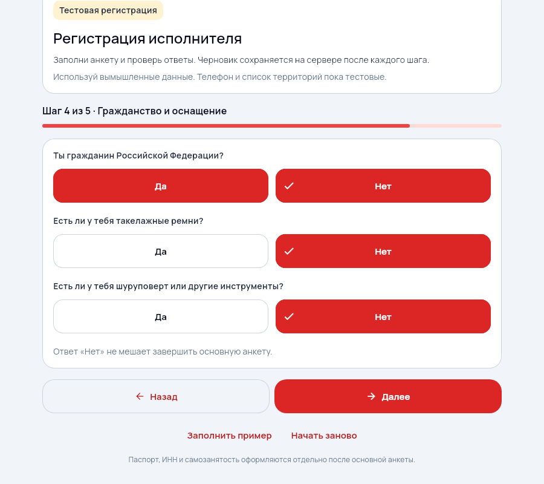
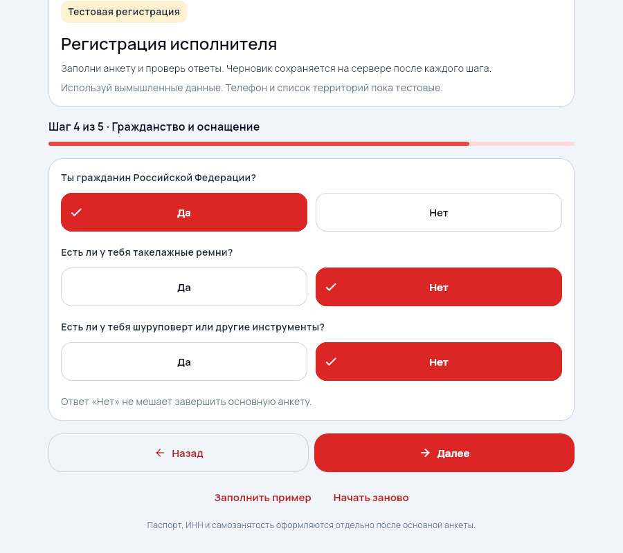

# GPM: аккуратные ответы «Да / Нет» — 20.11.2026

## Результат

В тестовой регистрации исправлены три выбора: гражданство РФ, ремни, инструменты.
Текст центрирован по ширине и высоте всей плашки; галочка выбранного ответа не сдвигает текст.
При наведении, фокусе и нажатии вся плашка становится фирменной красной, текст белый.
Выбранный ответ остается красным и отмечается галочкой; при уходе мыши невыбранный ответ снова белый.
На узком экране при крупном тексте ответы располагаются друг под другом.

Ссылка: https://app.gpmbot.ru/registration-preview/
Новый компонент используется только в этой анкете; общие кнопки приложения и серверные правила не менялись.
Проверка номера из предыдущего выпуска сохранена. Тестовый код 123456, серверный черновик, тестовые территории и необязательное отчество сохранены; рабочий аккаунт не создается.

## Выпуск и проверки

PR #23; код ветки 000e0c313c70a4d4aa79692757fa87fc2f533ace.
Frontend merge bdfef0115e4bf9acd8638b28840faa87d295fcd1.
Production frontend 44736089624 SUCCESS; повторный PR CI 44735831020 SUCCESS.

- Backup 44735346474 SUCCESS: расшифровка, хеши, изолированное восстановление PostgreSQL и тестовой SQLite.
- CI 44735566428 SUCCESS: analyze, 183 Flutter tests, 150 backend tests и две web-сборки.
- Registration QA 44735566283 SUCCESS: 35 проверок, 50 синтетических снимков, в том числе наведение и выбранный ответ.
- Проверены точные центры текста/кнопки, полная высота подсветки, наведение и нажатие у нижнего края, галочка выбора, ширина 320px и масштаб текста 200%.
- Live HTTP: анкета, новая сборка и API health — 200. Публичный JS содержит новый компонент выбора; SHA256 отдельной сборки 2b10bff91ceb95b1db7521ca0e0bca29af349cab794eed0ab1b5e5ac973927b9. Основная сборка совпала с прежней: 32c36543f066ee9a809fbbec5148967f1e7cf60005c883f82c8a93cb1d8d5e3f.
- Удаленная среда разработки синхронизирована: 44736380419 SUCCESS.

Примеры без пользовательских данных:

Предыдущий frontend сохранен штатным workflow для отката. Адреса серверов, пути хранения, секреты, ответы анкет и архивы в этот публичный контекст не включены.

## Продолжение и ограничения

Следующий шаг — визуальная приемка владельца: наведение, выбор каждого ответа, проверка на телефоне.
Перед рабочим подключением остаются решения о входе/подтверждении телефона, источнике территорий и обязательности отчества.
Основной контекст анкеты — PROJECT_HANDOFF_2026-11-20_REGISTRATION_PREVIEW.md; проверка телефона — PROJECT_HANDOFF_2026-11-20_REGISTRATION_PHONE.md.
Ручная приемка трех ролей, остальные этапы замечаний и решение QR/окончательной приемки не закрыты.

Работа через GitHub/Actions и собственные серверы GPM, без локальных копий исходников, SDK или архивов.
Backend, рабочие аккаунты/auth/JWT, БД и CRM/TS не менялись. Основная CRM только read-only в согласованном аудите; ее выпуск не разрешен.
Очистка заявок не разрешает удалять таблицы, аккаунты, авторизацию, backup и инфраструктуру.
Для изменения жизненно важных компонентов требуется отдельный согласованный объем. Debt-off и ежедневные письма TS оставлять отключенными; обычные email-коды не менять.
